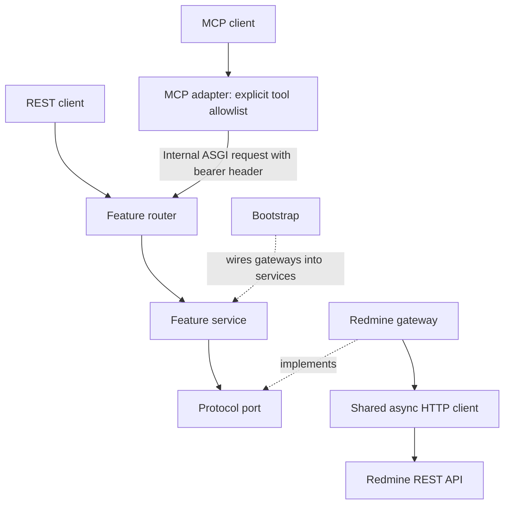

# Architecture

The service calls the implementation supplied through its port. Only Redmine owns database
access; the diagram describes runtime dependencies, not the separate administrative seed tools.

A modular monolith with projects/issues features. Only redmine_mcp is packaged for runtime.
Features contain models, small Protocol ports, services and routers. Concrete adapters
live in integrations/redmine. Services depend on interfaces, not FastAPI or HTTPX.

app.create_app reads settings and registers routers. bootstrap wires dependencies.
Lifespan manages the shared upstream client and closes the internal ASGI client at shutdown.
Imports do not load credentials or call the network.

Register routes before MCP creation, use stable operation IDs and an explicit allowlist.
Bearer dependencies protect REST and MCP; authorization is forwarded to internal ASGI calls.
Pydantic models are shared with response schemas until the contracts diverge.

Only bootstrap selects concrete implementations. Gateways do not import routers/services.
Common code contains errors, pagination, and shared visibility response models. The Redmine
gateway records field omissions before Pydantic supplies optional defaults. No generic CRUD
repository or connector framework is needed. MCP owns no database/cache; PostgreSQL belongs to
Redmine.

Errors are sanitized. Credentials and complete issue bodies must not be logged.
HTTPX/FastAPI-MCP debug logging is suppressed. Docker Uvicorn access logging is disabled.

Base Compose runs MCP only. The synthetic override adds Redmine/PostgreSQL and optional
seed/backup services. Administrative tools are not shipped in the runtime image.
Image pins provide development reproducibility, not production security certification.
OAuth, individual identities and hosting remain deferred. Current tools are read-only; future
issue writes are authorized after workflow prerequisites, in a separate opt-in restricted writer
deployment. The required automated testing baseline is still pending a separate assignment.

See [development](development.md) for adding tools, [configuration](configuration.md) for settings,
and [tool reference](tool-reference.md) for public contracts.

