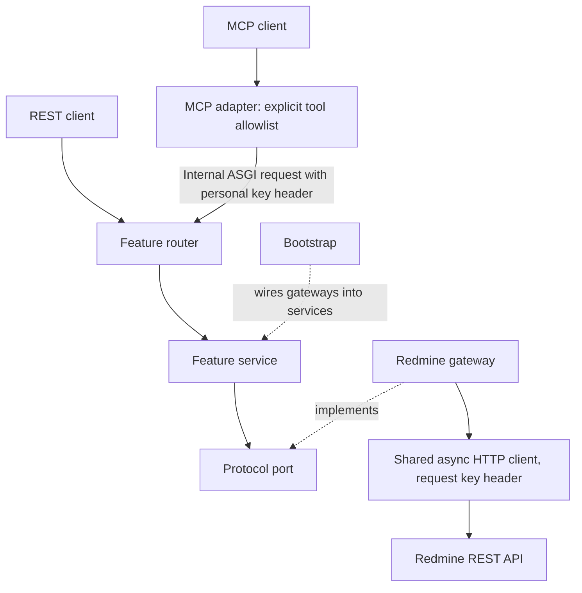

# Architecture

The read-only `list_my_project_capabilities` route is implemented in the users feature.
Its service combines the project reader Protocol with the request-local capability service
and caller-key Redmine adapters. Bootstrap supplies the deployment write ceiling and account
admission. Discovery and the report share project-operation permission evaluation. Role reads
are deduplicated per request, never across callers or requests. The report is advisory and does
not execute tools; runtime write authorization remains independent of reported candidates.
Project read evidence is evaluated through centralized rules in the users feature: OR between
permission branches and AND within a branch. The merged role permission union supplies the
evidence; project listing and explicit administrator status provide additional read evidence.
Conditional candidates retain module, container and resource visibility checks on invocation.

See [MCP request and response flow](mcp-request-flow.md) for the complete startup,
authentication, tool dispatch, validation, response, error, and shutdown sequence.

The service calls the implementation supplied through its port. Only Redmine owns database
access; the diagram describes runtime dependencies, not the separate administrative seed tools.

A modular monolith with resource-focused features, including projects, issues, users,
attachments and time entries. Only redmine_mcp is packaged for runtime.
Features contain models, query contracts, small Protocol ports, services and routers. Concrete adapters
live in integrations/redmine. Services depend on interfaces, not FastAPI or HTTPX.
HTTP status constants are the narrow exception: `from fastapi import status as http_status`
is allowed across layers. Framework APIs, request/response types, and transport clients remain
forbidden in domain and service contracts.

app.create_app reads settings (or accepts an explicit Settings instance) and registers routers.
bootstrap wires dependencies.
`lifecycle.py` owns both HTTP clients and MCP transport startup/shutdown through an async exit stack.
Cleanup is registered before later acquisitions; one cleanup failure does not skip other cleanup.
The MCP adapter waits for the SDK session manager's `run()` context to enter before application
startup finishes. This avoids FastAPI-MCP 0.4's lazy-start race for simultaneous first connections.
Each application instance owns one lifespan; construct a new instance for another runtime.
Imports do not load credentials or call the network.

`mcp/compatibility.py` owns vendor-private integration through the typed `MCPCompatibility`
facade. It supports exactly FastAPI-MCP 0.4.0 and MCP SDK 1.30.0, checks registration hook
shapes before installation and transport/lifecycle shapes after mounting and before readiness.
Unsupported versions or incompatible hooks fail with the existing sanitized startup message.
No fallback disables authentication, schema validation, budgets or membership DELETE bodies.
The facade owns REST-hook replacement, handler/cache access, native request-context extraction,
manager/task coordination and shutdown. Discovery, budget, catalog, annotations and schema
policy remain in their existing modules; `register_mcp`, `start_mcp`, `shutdown_mcp` and
`app.state.mcp` retain their entry points. No process-global facade/cache is introduced.

Registration retains this order: catalog selection/validation, exact membership DELETE-body
compatibility, schema repair/annotations, deep-copied deployment cache seeding, personal-writer
discovery, budget wrappers, mount/transport validation, then lifespan manager startup/readiness.
Discovery returns caller-selected copies without replacing the invocation schema superset.
Manager readiness is published only after `run()` enters; startup failure/cancellation settles
the future and cancels/awaits the owned task. Shutdown consumes owned task failures without
logging their contents, clears readiness and propagates external cancellation. Client cleanup
remains owned by the existing lifespan exit stack. PREP-026 runtime acceptance is pending.

Register routes before MCP creation. Feature routes own stable operation IDs, descriptions, and
schemas; `mcp/catalog.py` explicitly selects which routes become MCP tools. Startup rejects a
catalog entry unless it matches exactly one route under `/api/v1/` with a response schema and
the corresponding authorization dependency. Readers require GET and `require_read_access`;
configured writers require POST, PUT, PATCH or DELETE and `require_write_access`.
Other REST routes need no MCP catalog entry. REST and MCP validate the personal Redmine key
through `/users/current.json`.
MCP forwards only that header to internal ASGI calls. A request-scoped principal contains the
verified Redmine user ID; a central policy explicitly names read and enabled write operations.
Pydantic models are shared with response schemas until the contracts diverge.

Only bootstrap selects concrete implementations. Gateways do not import routers/services.
Common code contains errors, pagination, and shared visibility response models. The Redmine
gateway records field omissions before Pydantic supplies optional defaults. No generic CRUD
repository or connector framework is needed. MCP owns no database/cache; PostgreSQL belongs to
Redmine.

## Runtime foundation

| Responsibility | Module | Boundary |
|---|---|---|
| Principal and credential context | `auth/models.py` | Immutable request identity; keys excluded from representations |
| Identity port and authentication service | `auth/ports.py`, `auth/service.py` | Framework-independent key validation and authentication; no HTTP calls |
| Explicit application permissions | `auth/policy.py` | Named read/write permissions, separate from upstream resource visibility |
| Header validation and FastAPI dependencies | `api/security.py` | Reject missing, repeated, oversized, or malformed keys before calling identity service |
| Current-user lookup | `integrations/redmine/identity.py` | Implements the identity port using the request's Redmine client |
| HTTP pool and timeouts | `integrations/redmine/transport.py` | Creates a credential-free, lifespan-managed client |
| Resource ownership | `lifecycle.py`, `api/runtime.py` | Ordered cleanup and checked access to the running client |
| Business query validation | `features/issues/queries.py`, feature services | Validated immutable queries, IDs, includes, and cross-field rules |
| MCP client hints | `mcp/annotations.py` | Explicit read/idempotence hints; never a substitute for authorization |
| Pinned SDK integration | `mcp/compatibility.py` | Checked private hooks, repaired schema cache, authenticated request context and transport lifecycle; policies remain outside |
| Upstream requests and status mapping | `integrations/redmine/client.py` | Per-request key; relative paths; redirects disabled; shared cookies excluded |
| Raw response envelopes | `integrations/redmine/responses.py` | Validate objects, arrays, identity, counts, and pagination before model conversion |
| Feature model conversion and visibility | `integrations/redmine/mapping.py` | Convert validated records and preserve omission observations |
| Correlation and request boundary | `api/middleware.py` | Pure ASGI middleware, including MCP streams; response `X-Request-ID` |
| Safe application and unexpected errors | `api/error_handlers.py` | Central sanitized REST error responses |
| Log configuration and context | `observability.py` | Context-local request IDs and safe event fields |

Authentication creates a request-scoped identity; it never caches keys or principals across
requests. FastAPI reuses its authentication dependency within a request. MCP connection
authentication and internal REST authentication remain separate checks. Authorization accepts
only the named read operations, configured write operations in `auth/policy.py`, and
`mcp:connect`; adding a route requires an explicit permission entry. MCP exposure remains
separately controlled by `mcp/catalog.py` and the deployment's writer ceiling.
Catalog validation rejects exposed tools lacking the corresponding authorization dependency.
The current catalog contains 18 reads and 16 writes; reader registration excludes all mutations.
Project time-entry activity discovery reuses the project reader/service/adapter and the native
project detail expansion, with `view_time_entries` as conditional capability evidence.
TOOL-040 testing was waived by the user. Own-time creation has a dedicated time-entry creator
Protocol/gateway, authenticated caller identity from bootstrap, issue-derived `log_time` evidence
and a single native POST followed by optional independent read-back. TOOL-041 testing remains
pending; older acceptance records cover their dated source revisions.
Standalone `allowed_all` expands to registered write IDs before catalog, REST and capability
checks, including future registered writes after upgrade. It does not bypass other gates.

The writer defaults to pinned-key authentication. Explicit personal-key mode authenticates
multiple callers independently and applies an optional user list only at the write boundary.
The MCP dependency adapts the authenticated caller to the SDK session-owner identity without
storing the raw key in its token object. SDK 1.30.0 owns stateful session binding and cleanup;
credential changes cannot reuse an existing session. Read/write deployment gates remain in REST.

Personal-key feature services invoke the typed `WriteAuthorizer` port after validated inputs.
`auth/capabilities.py` combines necessary permission expressions with explicit denied, conditional
and unknown evidence. `integrations/redmine/capabilities.py` reads the caller profile/roles and
resolves real issue, journal, relation and attachment targets through same-key reads. Capability
snapshots and deduplicated role reads live only in the request's container. The check has a bounded
aggregate deadline. Visibility/ownership/field/tracker/workflow conditions still belong to Redmine;
local permission presence never substitutes for upstream authorization. Existing write gateways
retain container proof, accepted/uncertain outcomes, no automatic retries and independent read-back.

`mcp/discovery.py` installs a raw SDK ListToolsRequest handler for personal writers and reads the
authenticated original request context. It returns request-local copies filtered by deployment
admission and capability evidence. The complete generated catalog remains the immutable schema
superset for invocation. The adapter seeds SDK 1.30.0's cache once instead of using its list-tools
decorator, which mutates shared schema state. Missing context fails closed; unknown permission
coverage remains a candidate and is resolved through the same REST boundary at invocation.
Validation inspects normalized route contracts, including lazy included-router contexts in newer
FastAPI versions. It rejects duplicate/hidden routes, incorrect read/write methods, missing
response schemas and tools without the corresponding authorization dependency. Generated MCP
tool names must exactly match the catalog. Version-dependent route inspection is isolated in
`api/routing.py`.

Authentication passes the normalized key to the identity port explicitly. The key used to verify
the user is therefore the same key retained in the request context; readers cannot prebind a
different key. API access to runtime settings is checked rather than relying on an unchecked cast.

The shared pool has separate connect and pool-acquisition timeouts and bounded connections.
Redmine calls explicitly exclude stored cookies and default authorization headers so pooled
connections do not share authentication state. Calls never follow redirects. `RedmineClient.get`
owns bounded retries for eligible GET failures; the low-level transport retains `retries=0`
for direct and proxy pools. Internal MCP-to-REST calls, middleware and mutations have no retry loop.
The response validator rejects boolean/string counts, negative counts, non-object rows, oversized
pages, and mismatched pagination echoes. Missing echoes remain supported for issues/projects;
time entries require both echoes. Detail reads must return the requested resource ID.
`ReadPolicy` adds a deadline for each HTTP read and a decoded-payload limit independent of the
pool's inactivity timeouts. Bodies are streamed into a bounded buffer and responses close in a
finally block; upstream error bodies are not consumed. See configuration for the precise limits.
All GET attempts and backoff share one acquisition deadline, clipped to an active budget's
absolute monotonic cutoff. Retry classification and injectable clocks, sleep and jitter live in
`integrations/redmine/retry.py`. A fresh request/buffer is used on each attempt; partial bytes
remain charged as decoded chunks arrive, without fixed-size buffering hiding a failed tail.
A response closes before waiting so the semaphore is available to others.
Budget checks before retry are non-charging; physical accounting stays in `AdmittedTransport`.
Cooperative batch clipping applies to GETs only, preserving in-flight mutations and receipts.
The in-process HTTPX ASGI client does not enforce its configured timeout as a whole-operation
timer; the existing explicit reader/capability scopes provide that boundary. Exhausted read-back
retries preserve accepted/uncertain writer receipts and never replay the mutation.

The lifespan-created upstream transport also owns one semaphore shared by readers, writers,
authentication and discovery. A permit covers acquisition through stream closure, with a bounded
admission wait. Request-scoped clients and containers never own separate semaphores.
Direct and environment-proxy transport pools share that same semaphore. Explicit HTTPX mounts
restore environment proxy routing, including `NO_PROXY` fallback to the admitted direct transport.
Framework-independent read-budget context tracks attempts, decoded bytes and elapsed time only
for a logical reader. REST reader middleware starts it before authentication; internal ASGI calls
inherit it. MCP dispatch/discovery explicitly start fresh budgets to avoid inheriting expired
transport/session task context, and writer dispatch clears that inherited context.
REST middleware checks the aggregate deadline before forwarding response headers. If synchronous
conversion has exhausted the deadline, it discards the pending response without buffering it and
returns the sanitized timeout at the outer middleware boundary. It does not raise that error
through the inner response sender, which already considers the response started.
Pagination gates compare matching-page counts and continuation depth with a configured ceiling;
they keep no cross-request query state. Large first pages are discovery previews.
Attachment metadata URLs are validated and optionally mapped to a browser-facing Redmine base.
Binary attachment content routes and cached download tool calls are disabled.

Request IDs are generated by the server. Internal ASGI calls inherit the current context; client
headers cannot select log identifiers. Logs include operation ID, status, duration, safe error
code, or exception type. They exclude headers, keys, URLs, query strings, bodies, exception
messages, and traceback locals. HTTPX/FastAPI-MCP debug logging is suppressed. Docker Uvicorn
access logging is disabled; use `--no-access-log` for local runs with the same logging policy.

Unhandled failures before response headers produce a sanitized `internal_error` response. A
failure after stream headers have been sent terminates the stream with a sanitized exception;
it cannot replace an already-started MCP response with a JSON error. Task cancellation propagates
normally. Completion logs for streaming requests measure the entire stream lifetime.

## Business rules and transport validation

Routers validate HTTP syntax and decode transport input. Services validate application requests
before invoking a port, including direct non-HTTP calls. `PageRequest` and `IssueSearch` are
immutable, strict input contracts. Invalid IDs, booleans used as IDs, invalid page sizes/offsets,
naive datetimes, unsupported sorts/status selectors, duplicate/unknown expansions, and missing
project scope are rejected before feature gateway dispatch. REST business-input failures retain
the existing `422 {"detail": "..."}` shape. Raw validation errors never enter public responses.

A router requires an RFC 3339 timestamp string; the service receives an aware Python datetime.
Category filtering and exclusion of subprojects require a project in the service query contract.
Upstream response validation remains in the Redmine adapters. Reference-data services remain
small because their current contract has no caller-provided business input or orchestration.

`bootstrap.py` selects concrete implementations for authentication and feature services. The API
layer obtains running resources and calls composition factories rather than constructing Redmine
gateways. Services invoke ports with named arguments to reduce positional filter mistakes.

## Applying the reference layout

| Reference area | Current repository choice | Reason and remaining boundary |
|---|---|---|
| `main.py`, `server.py` | App factory plus `bootstrap.py` | Each instance owns its configuration and clients; global state would complicate isolation |
| `auth/` | Models, ports, service, and policy | Personal-key flow is explicit; OAuth/proxy/login require separately specified workflows |
| `cleanup.py` | `lifecycle.py` | Cleanup handles partial startup and cleanup failures; no background cleanup task exists |
| `tooling/` | `mcp/catalog.py`, `registration.py`, `annotations.py` | Explicit exposure and hints; REST dependencies enforce permissions for REST and MCP |
| `redmine/` | `integrations/redmine/` | Transport, response envelopes, feature mapping, and visibility stay within adapters |
| `http/` | `api/` plus feature routers | Shared request/error/auth handling stays in API; transport contracts stay with each feature |
| `tools/` | `features/` with services and ports | Resource grouping retains business boundaries and shared REST/MCP behavior |
| Attachments and upload store | Metadata/browser links and bounded writer upload tokens | MCP content download is retired; native Redmine owns attachment storage and retention |
| Extensions, apps, custom fields, offload | Future capability specifications | Registration, MCP App UI, custom-field semantics, or blocking work require actual use cases |

Static architecture checks run inside `scripts/check.sh`. They parse imports without loading the
application, reject transport/infrastructure imports in domain/service contracts, reject gateways
importing services/routers, enforce API-to-bootstrap composition, and detect local import cycles.
This is an import dependency gate; it does not prove runtime permission or business correctness.
Rules also cover package-root imports and nested contract modules, prevent common/auth modules
from depending on feature implementations, and prevent domain code from importing feature routers.

Base Compose runs MCP only. The synthetic override adds Redmine/PostgreSQL and optional
seed/backup services. Administrative tools are not shipped in the runtime image.
Image pins provide development reproducibility, not production security certification.
OAuth and hosting remain deferred. The reader remains read-only; implemented mutations require
the separate opt-in writer, configured operations, caller admission and native permissions.
Single-attempt mutation receipts distinguish acceptance, uncertainty and independent read-back;
received HTTP 500-599 is uncertain across JSON and binary writes. No automatic retry or rollback
is implied. See [write outcomes](tool-reference.md#mutation-uncertainty).

The [2026-10-07 acceptance ledger](testing/evidence/current-catalog-acceptance.md) records functional
evidence against owned Redmine 7.0.2 and remaining historical variants. Liveness is not upstream
readiness; complete audit, metrics, CI and recovery behavior remain deferred outside the
current local-development roadmap.

See [development](development.md) for adding tools, [configuration](configuration.md) for settings,
and [tool reference](tool-reference.md) for public contracts.

