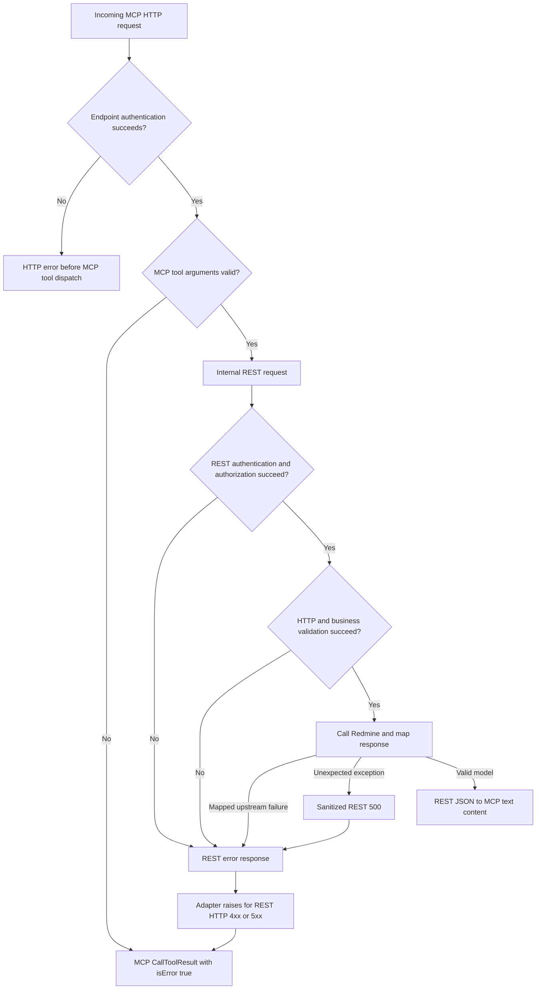

# MCP request and response flow

This describes the current repository and the installed FastAPI-MCP adapter. The example
uses `get_issue`; other reader tools follow the same layers with their own services and
gateways. This is a source walkthrough, not a report of live MCP verification.

## 1. Startup prepares the server

`app.create_app()` reads and validates settings, configures logging, registers request
middleware and exception handlers, and includes the feature REST routers. It creates an
internal HTTPX client using `ASGITransport`, so MCP can invoke those routes in process.
`http://apiserver` is this client's base URL, not another deployed service.

`mcp.registration.register_mcp()` validates the explicit operation catalog, generates tool
definitions from OpenAPI, validates the generated tool names, adds read-only annotations,
and mounts Streamable HTTP at `/mcp`. Descriptions and parameter schemas come from the
feature routers. Only allowlisted operations are published as tools.

`RuntimeLifecycle.lifespan()` then creates the shared Redmine HTTP client and places it in
`app.state.upstream`. It registers cleanup for both clients and the MCP transport. The
server can serve requests after the lifespan yields.

## 2. Connection and discovery

The MCP client connects to `/mcp` with `X-Redmine-API-Key`. MCP initialization negotiates
protocol capabilities; `tools/list` returns the generated tool definitions, including
names, descriptions, input schemas, and annotations. The client can use this information
to choose a tool. Discovery does not call a feature service to fetch project or issue data.

The HTTP endpoint is protected by `require_mcp_access`, including initialization and
discovery requests. Each incoming HTTP request runs the endpoint's authentication
dependencies; an MCP session does not replace the API key requirement. A persistent
Streamable HTTP connection can carry server messages separately from tool-call POSTs.

## 3. Successful tool call

Example MCP JSON-RPC message, sent to `/mcp` with the API key header:

```json
{
  "jsonrpc": "2.0",
  "id": 7,
  "method": "tools/call",
  "params": {
    "name": "get_issue",
    "arguments": {
      "issue_id": 123,
      "include": "journals,attachments"
    }
  }
}
```

```mermaid
sequenceDiagram
    autonumber
    participant C as MCP client
    participant M as Request middleware
    participant A as Authentication and policy
    participant MCP as MCP SDK and FastAPI-MCP
    participant R as Internal REST route
    participant S as IssueService
    participant G as RedmineIssues gateway
    participant H as RedmineClient
    participant RM as Redmine REST API

    C->>M: POST /mcp: tools/call + API key
    M->>M: Set request ID and start timing
    M->>A: require_mcp_access
    A->>H: Verify identity using request key
    H->>RM: GET users/current.json
    RM-->>A: User identity via RedmineClient
    A->>A: Authorize mcp:connect
    A-->>MCP: Authenticated request
    MCP->>MCP: Validate arguments against inputSchema
    MCP->>M: Internal ASGI GET /api/v1/issues/123
    Note over MCP,M: Forward allowed API key header; include becomes query parameter
    M->>R: Apply middleware to internal request
    R->>A: get_auth_context + require_read_access
    A->>H: Verify identity again for REST request
    H->>RM: GET users/current.json
    RM-->>A: User identity via RedmineClient
    A->>A: Authorize read:get_issue
    R->>R: Resolve request-scoped container and validate HTTP inputs
    R->>S: get_issue(123, selected includes)
    S->>S: Validate ID and include selection
    S->>G: Call IssueReader implementation
    G->>H: GET issues/123.json with include
    H->>RM: Request with personal API key
    RM-->>H: HTTP status and streamed JSON body
    H->>H: Check status, body limit, deadline, and JSON
    H-->>G: Parsed upstream object
    G->>G: Validate resource ID and IssueDetail; build visibility
    G-->>S: IssueDetail
    S-->>R: IssueDetail
    R-->>MCP: Validated REST JSON response
    MCP->>MCP: Encode JSON into MCP TextContent
    MCP-->>C: CallToolResult: content + isError=false
    Note over M,H: Completion logs record durations/status; middleware adds X-Request-ID
```

### Responsibilities at each step

| Stage | Current implementation | Responsibility |
| --- | --- | --- |
| Request context | `api/middleware.py` | Create a request ID or inherit an active context, time requests, add `X-Request-ID`, and log completion. Applies to both external and internal ASGI requests. |
| Authentication | `api/security.py`, `auth/service.py`, `integrations/redmine/identity.py` | Require exactly one API key header, normalize and validate its characters/length, call `users/current.json`, and construct an `AuthContext`. |
| Application authorization | `auth/policy.py` | Check `mcp:connect` at the MCP endpoint and the explicit `read:<operation_id>` permission at the REST route. Redmine remains responsible for resource visibility. |
| MCP dispatch | Installed FastAPI-MCP and MCP SDK | Look up the tool, validate the input schema, convert path/query arguments, and forward the allowed API key header to the REST endpoint. |
| Dependency wiring | `api/dependencies.py`, `bootstrap.py` | Build services and gateway objects for this REST request using its normalized key and the shared HTTP pool. FastAPI reuses the auth dependency result within that REST request. |
| HTTP validation | Feature router and FastAPI | Validate path/query types and bounds, decode `include`, and reject malformed HTTP input. |
| Business validation | Feature service and query contracts | Validate IDs, supported expansions, and cross-field constraints before calling a port. Direct service callers also receive this validation. |
| Port | `features/issues/ports.py` | Define the interface expected by the service; the supplied gateway implements it. The port does not make a separate network call. |
| Upstream translation | `integrations/redmine/issues.py` | Convert tool intent into Redmine resource paths and query parameters. |
| HTTP execution | `integrations/redmine/client.py` | Send the request with its personal key, enforce deadlines and body limits, map failures, decode JSON, and close the streamed response. |
| Response mapping | `integrations/redmine/responses.py`, `mapping.py`, `visibility.py` | Validate envelopes/resource identity and models, then describe selected missing or unrequested fields. |
| REST serialization | FastAPI response model | Validate and serialize the returned model according to the route's response contract. |
| MCP serialization | Installed FastAPI-MCP | Convert successful REST JSON to JSON text inside MCP `content`. |

For a normal successful `get_issue` call, the current implementation makes **three Redmine
requests**: identity verification for `/mcp`, identity verification for the internal REST
request, and the issue lookup. There is no identity cache shared between those two requests.
Objects holding a user's key are request-scoped; the credential-free connection pool is
shared. MCP does not access PostgreSQL directly.

## 4. What the client receives

The adapter currently returns text content containing serialized JSON. For example, the
following abbreviated result illustrates the MCP wrapper; omitted issue fields would be
present in the actual REST payload:

```json
{
  "jsonrpc": "2.0",
  "id": 7,
  "result": {
    "content": [
      {
        "type": "text",
        "text": "{\"id\":123,\"subject\":\"Example issue\",\"visibility\":{\"scope\":\"requesting_redmine_user\",\"observations\":[]}}"
      }
    ],
    "isError": false
  }
}
```

The adapter does not currently produce a native `structuredContent` result. The client
reads the JSON text to obtain the issue data. The HTTP response can be delivered as JSON
or through Streamable HTTP's SSE framing, depending on the transport exchange.

`visibility.scope` means results reflect the requesting Redmine user's access.
`not_returned` means a tracked field was absent from Redmine's payload; its cause is unknown.
`not_requested` marks an expansion absent from the payload that was not selected.
An empty observations list does not establish system-wide completeness.

## 5. Error branches



| Failure | Handling and outcome |
| --- | --- |
| Missing/invalid API key at `/mcp` | HTTP 401 before tool dispatch. A forbidden identity response is normalized to invalid credentials. |
| Redmine unavailable during endpoint authentication | Mapped HTTP error before tool dispatch, such as 502 or 504. |
| Invalid MCP arguments | The installed SDK returns `isError: true` without invoking the feature REST route. Endpoint authentication has already happened. |
| Unknown tool | The adapter rejects the name; the SDK converts the exception into a tool error. |
| Invalid REST path/query | FastAPI returns HTTP 422 using its validation error body. |
| Invalid business input | `InvalidInputError` becomes REST HTTP 422 with `{"detail": "..."}`. |
| Redmine 403 / 404 during resource lookup | REST HTTP 403 / 404 with an error code and sanitized message. A 404 does not establish whether the resource is absent or hidden. |
| Redmine rate limit, unavailable server, network failure, malformed data, or oversized response | Mapped REST error; most become 502. Pool exhaustion becomes 503, and timeout becomes 504. |
| Unexpected application error | Sanitized REST HTTP 500 with `internal_error`; application logging records the exception type rather than its message. |

Other `ApplicationError` responses use this REST shape:

```json
{
  "error": {
    "code": "resource_not_found",
    "message": "Resource unavailable or not visible"
  }
}
```

If the failure occurs on the internal REST request, the installed adapter raises an exception
whose text includes the tool name, REST status, and response body. The SDK places that text
in a tool result with `isError: true`. The client should not rely on the outer MCP HTTP status
alone to determine whether a tool succeeded. Endpoint failures and malformed protocol
messages are separate from this tool-result error path.

## 6. Logging and shutdown

Application log templates record request IDs, operation names, status codes, durations,
and sanitized error codes/types. The upstream client records completion for each Redmine
request. The internal REST request and the external MCP HTTP request each run middleware;
the middleware inherits an active request-ID context when available, otherwise creates one.
It replaces the outgoing `X-Request-ID` header. The installed adapter does not copy the
internal REST response headers into the MCP result content.

The upstream request strips cookie and authorization headers, sends the request's API key,
does not follow redirects, and always closes streamed responses. There is no retry loop.
Application-owned logging avoids keys and raw upstream error bodies. Third-party adapter
logging can include its generated tool exception and the internal REST error body.

On shutdown, the lifespan clears `app.state.upstream` and unwinds `AsyncExitStack`: MCP
transport shutdown, upstream HTTP client closure, then internal HTTP client closure.
Each application instance owns one lifespan and cannot be started twice.
