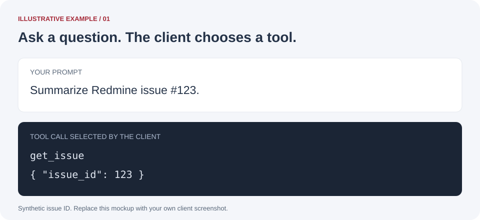
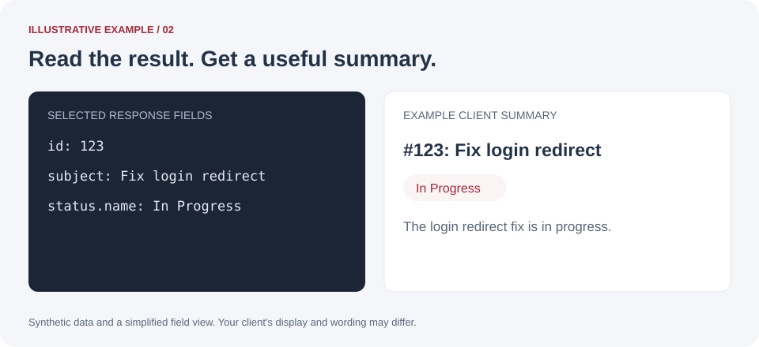
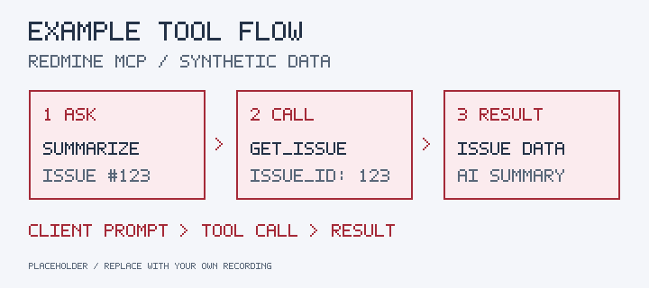
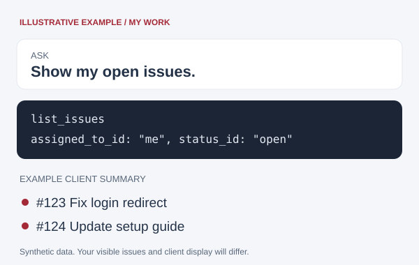

# See a tool call in action

These images and the animation use synthetic data. They illustrate the workflow and are
placeholders for future screenshots and recordings; they are not captured tool executions.
The example assumes a connected MCP client and an issue visible to the caller.

## 1. Ask your client

Try a request such as **Summarize Redmine issue #123.** Replace `123` with a visible issue ID.
The client can select `get_issue` with `{"issue_id": 123}`.

## 2. Read the result

The server checks access, reads the issue from Redmine, and returns the result through MCP.
The client can turn that data into a short summary. This image shows selected fields with
invented values; consult the [tool reference](../docs/tool-reference.md) for the full contract.

## 3. Watch the flow

The static overview shows the same three stages as the looping GIF below.

Show the looping example GIF

**Animation transcript:** Ask for issue #123 → call `get_issue` with `issue_id: 123` →
read the returned issue and summarize it. Actual client interfaces and timing vary.

## Try another read

### Find your open issues

Ask **Show my open issues.** The client can use `list_issues` with
`{"assigned_to_id": "me", "status_id": "open"}` to find open issues assigned to the caller.

### Discover your projects

Ask **Which projects can I access?** The client can use `list_projects` and summarize
the projects returned for that caller. Larger results may require pagination.

| Example prompt | Tool the client can use |
| --- | --- |
| Who am I connected as? | `get_current_user` |
| Show the projects I can access. | `list_projects` |
| Summarize issue #123. | `get_issue` with `issue_id: 123` |

Use [MCP client installation](get-started.md) to connect your client, or
[REST and Inspector examples](first-calls.md) for explicit request examples.

## Try it with your own work

Follow [Find my open issues](my-issues.md) for a project-specific task list, or
[Understand an issue](issue-summary.md) for discussion context and suggested follow-up.
For a progress update or time report, choose an [everyday workflow](workflows.md).

Your results depend on your account, filters, and available pages. Ask the client to explain
missing data and incomplete collection before relying on a summary.
