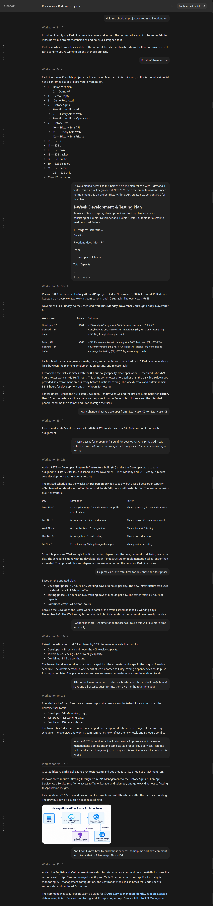
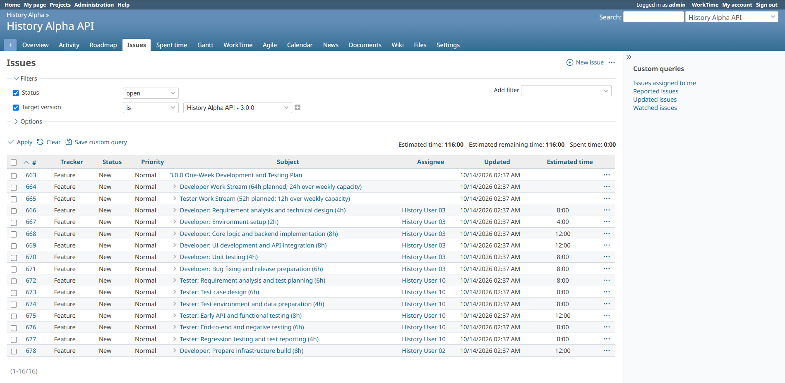
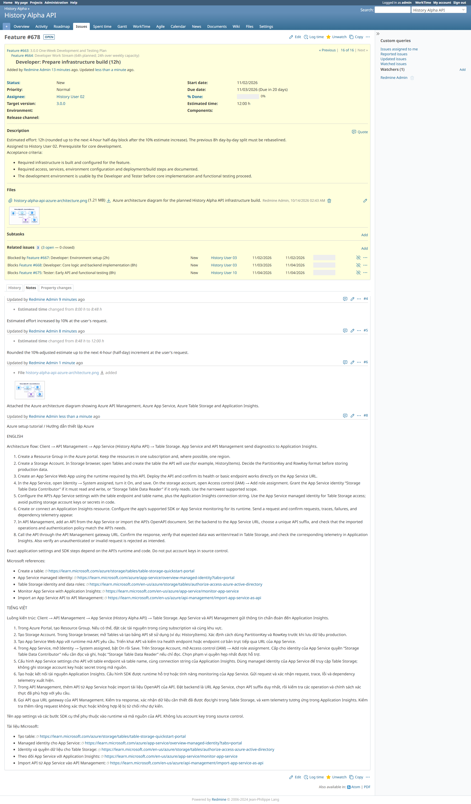

## Explore a feature plan in Redmine

An example of using Redmine MCP to plan and implement features.
This is a recorded example; available actions depend on your access and server configuration.

<figure class="portal-feature-image">
  <figcaption>
    Planning stock features · Scroll to explore
    <a class="portal-image-action" href="assets/imgs/implement-stock-feature-example.png" target="_blank" rel="noopener noreferrer">Open full-size image (new tab)</a>
  </figcaption>
  

    
  

</figure>

<figure class="portal-feature-image">
  <figcaption>
    Result in Redmine · Issue list
    <a class="portal-image-action" href="assets/imgs/Screenshot_46.png" target="_blank" rel="noopener noreferrer">Open issue list (new tab)</a>
  </figcaption>
  

    
  

</figure>

<figure class="portal-feature-image">
  <figcaption>
    Result in Redmine · Feature #678
    <a class="portal-image-action" href="assets/imgs/Feature-678.png" target="_blank" rel="noopener noreferrer">Open Feature #678 (new tab)</a>
  </figcaption>
  

    
  

</figure>

Redmine MCP / User guide

# Work with Redmine from your AI client

Find your tasks, understand an issue, and prepare a progress update without copying data
between Redmine and your AI client. Redmine MCP gives a compatible client tools to read
Redmine using your personal account. A separately enabled writer can also make changes.

  <a class="portal-card portal-card-featured" href="#/guides/reference"><strong>Supported tools and capabilities</strong>See what you can do with Redmine MCP, which actions need writer access, and the limits to expect.</a>
  <a class="portal-card" href="#/guides/get-started"><strong>MCP client installation</strong>Set up your AI app or extension and connect it to an existing server.</a>
  <a class="portal-card" href="#/guides/installation"><strong>MCP server installation</strong>Install and run the Redmine MCP server with Python or Docker.</a>
  <a class="portal-card" href="#/guides/workflows"><strong>Explore everyday workflows</strong>Copy prompts for issues, progress updates, and time reports.</a>
  <a class="portal-card" href="#/guides/troubleshooting"><strong>Get help</strong>Resolve connection problems, missing results, and unavailable actions.</a>

## Try a question

| What you want to do | Example prompt | Walkthrough |
| --- | --- | --- |
| Find your next task | Show my open issues in the Website project, grouped by priority. | [My open issues](guides/my-issues.md) |
| Catch up on a discussion | Summarize issue #123 and its recent notes. | [Understand an issue](guides/issue-summary.md) |
| Review your time | Summarize my logged hours from 2026-10-05 through 2026-10-09 by project. | [Time reports](guides/time-report.md) |

Names, IDs, dates, and sample results are illustrative. Replace them with your own scope.
Your client chooses tools and formats its answer; prompts are examples, not built-in commands.
[See REST and Inspector examples](guides/first-calls.md).

## What you can expect

- Results reflect the account associated with your personal Redmine API key.
- Reading works on the default server. Changes require a writer connection, enabled actions,
  and your normal Redmine permissions.
- Large queries may return a preview. Ask for a smaller project or date range before
  treating a summary as complete.
- Attachment tools provide metadata and browser links. Open the links in Redmine to read files.

The primary target is Redmine **7.0.2**. Built-in sample and E2E profiles cover **6.0.1 and
7.0.2**; see [server installation](guides/installation.md) and [testing](guides/testing.md)
for their setup. This is an unreleased pilot implementation; support and acceptance vary
by operation and recorded deployment. The [reference guide](guides/reference.md) links to exact
contracts and recorded limitations.

## Where to go next

Start with [MCP client installation](guides/get-started.md), then choose an
[everyday workflow](guides/workflows.md). Administrators can use
[MCP server installation](guides/installation.md) and [access setup](guides/access.md).
Contributors can find architecture, development, and testing material in the
[contributor documentation](guides/contributors.md).

Documentation is maintained in English only. Example screenshots retain their original text.

## Technical references

Pages linked from the earlier Overview remain available here.

| Topic | Pages |
| --- | --- |
| Configuration | [Runtime settings](docs/configuration.md) |
| Tool contracts | [Tool reference](docs/tool-reference.md), [manual verification](docs/manual-verification.md) |
| Implementation | [Module map](guides/module-map.md), [architecture](docs/architecture.md), [execution flow](docs/mcp-request-flow.md) |
| Development | [Development](docs/development.md), [tool workflow](docs/workflows/redmine-tools.md) |
| Operations | [Operations](docs/operations.md), [synthetic data](docs/test-data.md) |
| Testing | [Testing overview](guides/testing.md), [coverage matrix](docs/plans/testing-coverage.md), [roadmap](docs/plans/index.md) |
| Portal | [Visual examples](guides/visual-examples.md), [maintenance](docs/documentation-portal.md), [manual checklist](guides/verification.md) |
