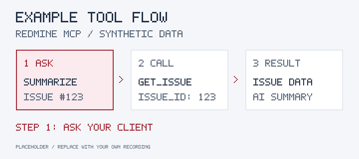
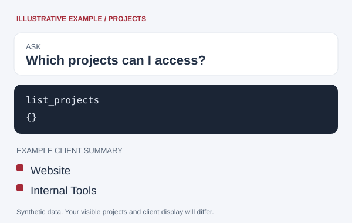

# Redmine MCP

> Connect your AI tools to Redmine.

<figure class="cover-showcase">
  <picture>
    <source media="(prefers-reduced-motion: reduce)" srcset="assets/examples/issue-flow.png">
    
  </picture>
  <figcaption>
    <strong>Ask: “Summarize issue #123.”</strong>
    Your client calls <code>get_issue</code> and summarizes the result.
    <small>Illustrative example with synthetic data.</small>
  </figcaption>
</figure>

  <figure class="cover-showcase">
    
    <figcaption>
      <strong>Find your next task.</strong>
      Ask for your open issues with <code>list_issues</code>.
      <small>Illustrative example with synthetic data.</small>
    </figcaption>
  </figure>
  <figure class="cover-showcase">
    
    <figcaption>
      <strong>Explore your projects.</strong>
      See accessible projects with <code>list_projects</code>.
      <small>Illustrative example with synthetic data.</small>
    </figcaption>
  </figure>

[Get started](/guides/installation.md)
[GitHub](https://github.com/Ng2Thang/redmine-mcp)
