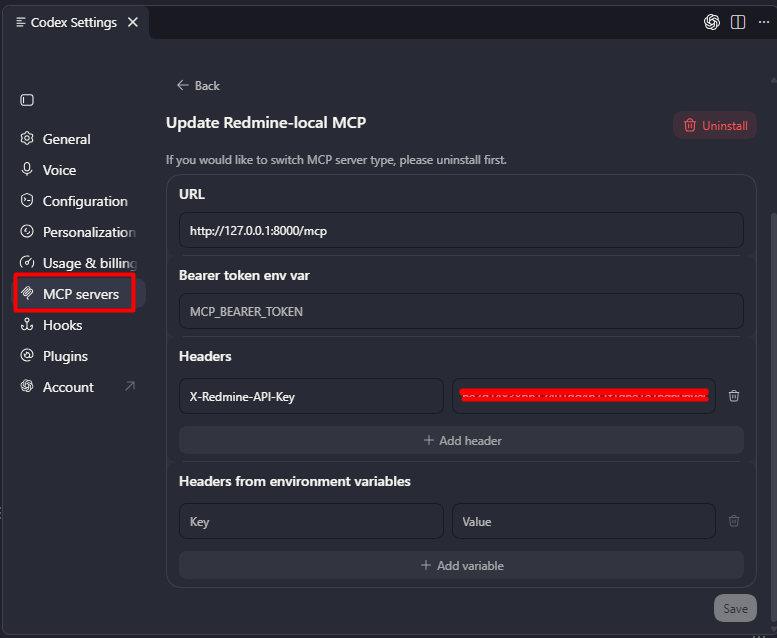

# MCP client installation

Set up an MCP-capable AI application or extension, then connect it to a running Redmine MCP
server. This is the client side: Codex in VS Code, GitHub Copilot, Cursor, or another compatible
tool. If your client is already installed, go straight to its connection instructions below.

You need an existing server URL. If you need to install and run the server yourself, follow
[MCP server installation](installation.md) first, then return here.

The sample Docker MCP URLs are `http://127.0.0.1:8002/mcp` for Redmine 7.0.2 and
`http://127.0.0.1:8001/mcp` for 6.0.1. The examples below use local Python on port 8000;
replace the URL with the endpoint for your deployment.

**Before you start**

- A running Redmine MCP server and its MCP URL, supplied by the person who installed it.
- Your personal Redmine API key. In Redmine, open **My account** and look for the API access
  key. If unavailable, ask your administrator whether REST API access is enabled.
- A client supporting MCP over **Streamable HTTP** and custom HTTP headers.

Use your own key and keep it in private connection settings, outside prompts and shared files.
You can use VS Code with an MCP-capable AI extension, Cursor, or another compatible client.
You do not need to clone this repository when connecting to an already running server.

Choose your client's section below or in the sidebar submenu. Use these connection values with its
configuration format:

| Setting | Value |
| --- | --- |
| Transport | Streamable HTTP |
| Server URL | The supplied MCP URL; for a local reader, `http://127.0.0.1:8000/mcp` |
| Header name | `X-Redmine-API-Key` |
| Header value | Your personal Redmine API key |

The URL ends in `/mcp`. `/docs` opens the REST reference and is not an MCP endpoint.
For a remote server, use the administrator's secured URL. `127.0.0.1` refers to the machine
running the client, so it will not reach a server on another machine.

## Codex extension in VS Code

1. In the Codex extension's gear/settings menu, select **MCP servers**, then **Add server**.
   Choose **Streamable HTTP** and enter a name such as `Redmine-local`.
2. Fill in the connection fields:

| Field | What to enter |
| --- | --- |
| URL | `http://127.0.0.1:8000/mcp`, or your administrator's MCP URL |
| Bearer token env var | Leave empty; this server uses the custom Redmine header below |
| Headers: key | `X-Redmine-API-Key` |
| Headers: value | Your personal Redmine API key |

Use **Add header** if a header row is not already present. Keep the key in your private
Codex settings; do not paste it into chat or a shared repository configuration.



*The screenshot shows the update screen for an already added server. Use the same URL
and header fields when adding yours. The API key value is obscured.*

3. Select **Save**, then **Restart extension**. Confirm the server is enabled in
   **MCP servers**, then send the **First request** below.

If you use **Headers from environment variables** instead, enter `X-Redmine-API-Key` as
the header name and the name of a variable containing your key, such as
`REDMINE_REQUEST_KEY`, as its value. The variable must be available to the extension's
Codex process. Use one header method so the key header is not duplicated.

Codex maintains its own MCP configuration, shared with its CLI on the same Codex host.
Adding this connection to Copilot's `.vscode/mcp.json` does not configure Codex.
See [official OpenAI documentation for Codex MCP setup](https://developers.openai.com/codex/mcp).

## VS Code with GitHub Copilot

This example uses VS Code's extension-host MCP configuration. Other AI extensions can have
their own MCP settings; adding a server here does not automatically configure every extension.

1. In VS Code with GitHub Copilot, press **Ctrl+Shift+P** and run
   **MCP: Open User Configuration** to configure your profile.
   For one workspace instead, edit `.vscode/mcp.json` in that workspace.
2. Add the example below. Merge `redmine` into existing `servers` and the prompt into existing
   `inputs` if you already have MCP servers; preserve the other entries.

```json
{
  "servers": {
    "redmine": {
      "type": "http",
      "url": "http://127.0.0.1:8000/mcp",
      "headers": {
        "X-Redmine-API-Key": "${input:redmine-api-key}"
      }
    }
  },
  "inputs": [
    {
      "type": "promptString",
      "id": "redmine-api-key",
      "description": "Your personal Redmine API key",
      "password": true
    }
  ]
}
```

The `http` type selects the HTTP transport. The password prompt supplies your key without
putting it directly in JSON. See the official
[VS Code configuration reference](https://code.visualstudio.com/docs/agents/reference/mcp-configuration).

3. Save, then run **MCP: List Servers** and start `redmine`. Enter your key and review any
   trust prompt. In Copilot Chat, select a tool-capable mode, enable Redmine under
   **Configure Tools**, and send the **First request** below.

Newer VS Code Agent Host sessions do not receive configurations using interactive
`${input:...}` prompts. For those sessions, follow the documented portable `.mcp.json`
or user `mcp-config.json` setup and supported secret handling instead of copying this
extension-host example unchanged. See
[VS Code server setup and session differences](https://code.visualstudio.com/docs/agent-customization/mcp-servers).

## Cursor

Add a `redmine` entry to `.cursor/mcp.json` for one project or `~/.cursor/mcp.json` for
all projects. Merge it with existing `mcpServers` entries:

```json
{
  "mcpServers": {
    "redmine": {
      "url": "http://127.0.0.1:8000/mcp",
      "headers": {
        "X-Redmine-API-Key": "${env:REDMINE_REQUEST_KEY}"
      }
    }
  }
}
```

This uses Cursor's environment-variable substitution. The variable must be available to
the Cursor process. For example, close the existing Cursor application, then launch it
from Git Bash in your project folder:

```bash
read -r -s -p 'Personal Redmine API key: ' REDMINE_REQUEST_KEY
printf '\n'
export REDMINE_REQUEST_KEY
cursor .
unset REDMINE_REQUEST_KEY
```

Enable the server in Cursor's MCP settings and use a tool-capable chat mode. Continue with
**First request** below. See the official
[Cursor MCP guide](https://prod.cursor.com/docs/mcp) for configuration and environment handling.

## Another VS Code extension or MCP client

1. In the application's **MCP servers**, **Tools**, or **Integrations** settings, add a
   remote server named `redmine`, using **Streamable HTTP** and your `/mcp` URL.
2. Add the custom header `X-Redmine-API-Key` through its private credential settings.
   If it uses JSON, follow its documented schema and secret substitution syntax.
3. Save, enable or reconnect the server, and select a tool-capable chat mode. Check that
   `get_current_user` and `list_projects` appear, then send the **First request** below.

VS Code uses `servers` in its native example; Cursor uses `mcpServers`. Do not assume
either whole file works unchanged in another extension. Redmine MCP uses an HTTP server;
a client offering only a command-based stdio connection is insufficient for this direct setup.
The API key goes in a custom header, not an OAuth sign-in or Bearer token field.

If your client cannot send custom headers, choose a compatible client or use
[Inspector](first-calls.md#optional-connect-with-mcp-inspector) to explore the tools.
If tools do not appear, check [connection troubleshooting](troubleshooting.md#the-client-cannot-connect).

## First request

After connecting, confirm your identity and discover the projects available to that account
in one request:

```text
Use Redmine MCP to tell me which Redmine account I am connected as.
Then show the projects I can access, including their IDs, and say whether
the list is complete or only a preview.
```

The client can call `get_current_user` and `list_projects`. Confirm the returned account
before relying on visibility or using write actions. Project results depend on permissions
and pagination; an empty list may be valid.

Continue with [Find my open issues](my-issues.md) using a returned project, or choose another
[workflow](workflows.md). If connection or results are unexpected, use
[troubleshooting](troubleshooting.md).
