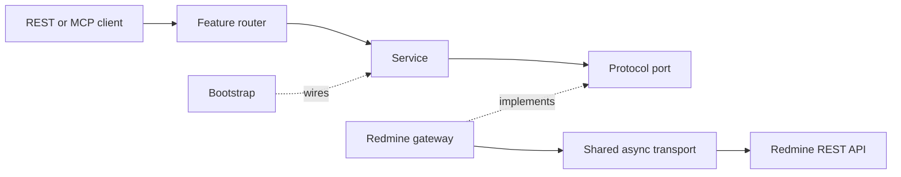

# Runtime module map

The runtime is a resource-focused modular monolith under `src/redmine_mcp/`. REST routers and
MCP share the same services and permission boundaries. The following map describes current
responsibilities; it is source documentation, not live verification evidence.

| Area | Responsibility |
| --- | --- |
| `app.py` | Read settings, register middleware/error handlers and REST routers, register MCP, attach lifespan |
| `config.py` | Validate runtime settings, reader budgets, writer operation gates, and upstream admission limits |
| `lifecycle.py` | Manage shared upstream/internal HTTP clients, MCP readiness, and shutdown |
| `bootstrap.py` | Supply concrete gateways to service ports and build request-scoped containers |
| `api/` | HTTP dependencies, authentication entry points, limits, health, routing, and error serialization |
| `auth/` | Principal/context contracts, authentication, access policy, and capability evaluation |
| `mcp/` | Explicit catalog, registration, schema repair, compatibility, discovery, and dispatch budgets |
| `features/` | Resource models, routers, query contracts, services, and Protocol ports |
| `integrations/redmine/` | Upstream transport, resource paths, retry policy, mapping, and mutation receipts |
| `common/` | Shared errors, validation, pagination, visibility, and read-budget contracts |
| `constants/` | Shared error codes, safe messages, and log/contract text |
| `observability.py` | Request context and sanitized logging configuration |

## Resource features

Projects, issues, users, attachments, time entries, and reference data own their models and
contracts. A feature router validates HTTP input and calls its service. The service validates
business rules and invokes a Protocol port. A Redmine gateway implements that port and translates
the intent into upstream requests. Bootstrap selects the concrete implementation.

Services do not import FastAPI APIs or HTTPX. HTTP status constants imported as
`from fastapi import status as http_status` are the narrow exception. MCP does not access
PostgreSQL directly.

## Execution checkpoints

1. **Startup:** create the app, validate configuration/catalog/compatibility, register routes and
   tool schemas, then enter lifespan and wait for MCP manager readiness.
2. **Authentication and discovery:** validate the personal key at `/mcp`; generate deployment or
   caller-specific candidates without granting target permissions.
3. **Dispatch:** validate MCP arguments and invoke the corresponding REST route through internal
   ASGI transport with the allowed key header.
4. **REST and service:** authenticate/authorize the REST request, resolve the request container,
   validate transport and business input, and call the feature port.
5. **Upstream and mapping:** enforce admission, budgets, deadlines and body bounds; eligible GETs
   may retry, while mutations remain single attempt. Validate and map upstream responses.
6. **Response and errors:** serialize the REST contract into MCP text content or a tool error;
   endpoint errors can occur before dispatch.
7. **Shutdown:** settle MCP manager tasks and close the lifespan-managed clients and transport.

The [full execution walkthrough](../docs/mcp-request-flow.md) contains sequence diagrams and
failure branches. The [architecture guide](../docs/architecture.md) explains import boundaries,
request-scoped credentials, compatibility pins, limits, and lifecycle ownership.

## Extend the server

Start with the [tool workflow](../docs/workflows/redmine-tools.md), then the
[development guide](../docs/development.md#add-a-read-only-tool). Preserve stable `operation_id`
values, explicitly register MCP operations, wire dependencies through bootstrap, and update the
public contract. Testing remains a separately authorized stage.
