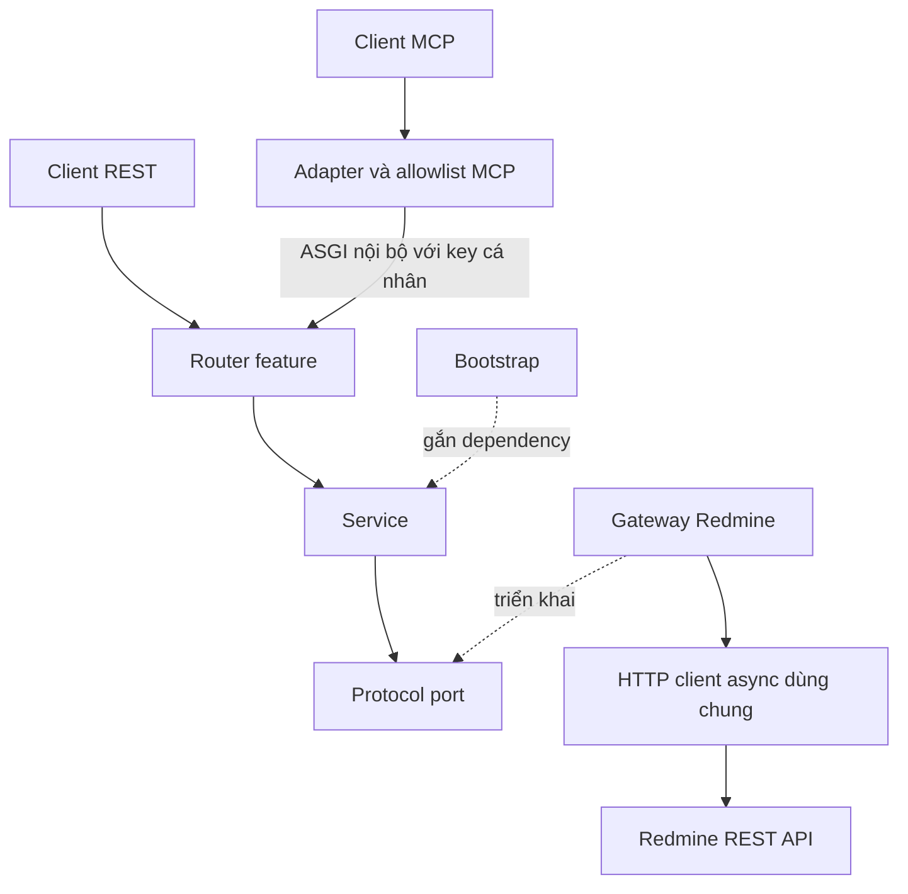

# Kiến trúc :id=architecture

> Bản tiếng Việt được biên tập từ [tài liệu tiếng Anh gốc](#/docs/architecture.md). Bản gốc là nguồn chuẩn cho hợp đồng và hồ sơ đầy đủ. Tên API, lệnh, ngày, waiver và giới hạn nghiệm thu được giữ nguyên; việc dịch không thực hiện kiểm thử.

Runtime tổ chức theo tài nguyên: project, issue, user, attachment và time entry. Feature chứa model/query, Protocol port, service và router. Adapter nằm trong `integrations/redmine/`; `bootstrap.py` chọn và gắn implementation. Service chỉ phụ thuộc port, không FastAPI/HTTPX; ngoại lệ hẹp là `from fastapi import status as http_status`. MCP dùng lại REST/service; Redmine sở hữu database, MCP không truy cập PostgreSQL trực tiếp. Seed quản trị nằm ngoài runtime.

## Startup và compatibility

`create_app` đọc hoặc nhận Settings rõ ràng, đăng ký REST trước MCP. Lifespan sở hữu HTTP client Redmine, HTTPX ASGI client nội bộ và transport, dùng cleanup có thứ tự. Lỗi cleanup của một tài nguyên không bỏ qua tài nguyên khác. Chỉ báo ready sau khi session manager đi vào context `run()`; mỗi app có lifespan riêng, import không đọc credential hoặc gọi mạng.

`mcp/compatibility.py` cô lập private integration của FastAPI-MCP 0.4.0/MCP SDK 1.30.0. Kiểm version/hook shape và mounted transport trước khi ready; sai thì fail an toàn, không fallback bằng cách tắt auth/schema/budget/DELETE body. Thứ tự: kiểm catalog → override DELETE body → phục hồi schema/hint → deep-copy deployment cache → personal discovery → budget wrapper → mount/kiểm transport → manager ready. Discovery không sửa invocation superset. Cancel/failure phải giải quyết ready future và dừng/await task thuộc sở hữu.

Catalog phải map mỗi operation tới đúng một route `/api/v1` có response schema và dependency xác thực. GET dùng `require_read_access`; mutation dùng `require_write_access`. Operation ID ổn định. Principal theo request giữ verified user ID và normalized key; policy read/write/mcp:connect tách khỏi visibility native.

## Nền tảng runtime :id=runtime-foundation

| Module | Trách nhiệm |
| --- | --- |
| `auth/models.py`, `ports.py`, `service.py`, `policy.py` | Identity/key context bất biến, xác thực độc lập framework và gate rõ ràng |
| `api/security.py` | Header/dependency; từ chối key thiếu, lặp, quá dài hoặc sai trước identity lookup |
| `integrations/redmine/identity.py`, `transport.py`, `client.py` | Identity adapter, pool không credential, caller-key request, retry/budget/stream/error mapping |
| `lifecycle.py`, `api/runtime.py` | Ownership, cleanup và truy cập resource đã startup |
| Feature query/model/service/port/router | HTTP syntax, business validation, contract và orchestration theo tài nguyên |
| `responses.py`, `mapping.py`, `visibility.py` | Envelope/ID/pagination validation, mapping và field omission evidence |
| `mcp/annotations.py`, `compatibility.py` | Hint không cấp quyền; registration/cache/context/transport/lifecycle compatibility |
| API middleware/error handlers và observability | Correlation, sanitized errors và metadata-only timing |

Danh mục 18 đọc/18 ghi không phải blanket acceptance. TOOL-040 waived; TOOL-041 pending. Update/delete time entry kiểm exact entry/issue/project/credited user và own/all permission; GET 404 không giải quyết uncertainty. `allowed_all` bao gồm writer hiện tại/tương lai nhưng không bypass gate.

Capability gộp mọi role đọc được, OR giữa permission branch và AND trong branch; đây là lời khuyên, không tự chạy công cụ. Personal discovery dùng authenticated context, schema cache superset bất biến và request-local bounded inventory. Thiếu context fail closed; unknown evidence vẫn là candidate. Startup từ chối route trùng, hidden, sai method/schema/dependency hoặc tên operation.

## Transport, budget và dữ liệu riêng tư

Pool có connect/acquisition timeout và giới hạn connection, không shared cookie/default auth/redirect. Low-level transport retry là 0; bounded GET retry ở client/retry layer. Mỗi attempt dùng buffer mới, charge physical request/bytes kể cả partial tail, close response/release capacity trước backoff. Deadline chung giới hạn admission, attempt và wait. GET đọc lại lỗi không replay mutation; batch deadline không hủy một mutation đang in-flight chỉ vì cooperative timer hết.

Semaphore dùng chung trong lifespan, giữ đến stream close. Logical read budget tính attempt/byte/time; REST bắt đầu trước auth, internal request kế thừa scope, MCP có scope mới. Conversion hết deadline trước headers trả safe 504. Pagination stateless: broad preview có thể yêu cầu thu hẹp trước continuation. Attachment chỉ metadata/browser link; không content download.

Request ID do server tạo, internal context kế thừa; caller không chọn log ID. Log chỉ operation/status/duration/code/type, không key/header/URL/query/body/exception message/traceback locals. Unexpected error trước headers trả safe 500; sau headers kết thúc stream an toàn, không thay JSON đã gửi. Streaming timing bao gồm toàn bộ lifetime.

## Quy tắc nghiệp vụ và validation transport :id=business-rules-and-transport-validation

Router kiểm HTTP type/syntax; service kiểm nghiệp vụ cả khi gọi trực tiếp trước port. Query bất biến và strict: ID, boolean-as-ID, paging/offset, naive datetime, sort/status/include và project scope sai bị chặn trước gateway. RFC3339 ở router chuyển thành aware datetime trong service; category hoặc loại subproject cần project scope. Response validation thuộc adapter; omitted field được ghi nhận trước khi model áp default.

## Áp dụng bố cục tham chiếu :id=applying-the-reference-layout

Factory/bootstrap thay global server; lifecycle thay background cleanup; API sở hữu auth/error/request, feature sở hữu resource contract, integration sở hữu HTTP/envelope/mapping. Gateway không import service/router. Upload storage/retention thuộc Redmine, MCP chỉ bounded upload token và metadata. OAuth/UI/offload/custom field cần use case và task riêng. Architecture checker resolve re-export, chặn import cycle và dependency đi ngược tầng; không load app.
