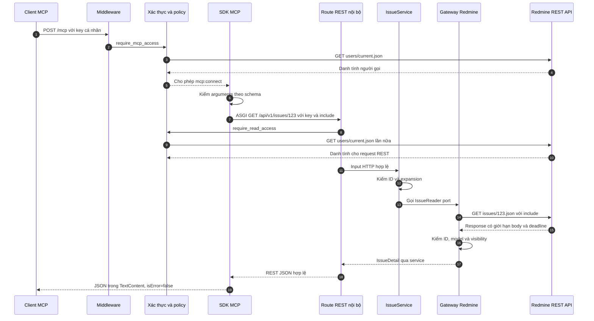
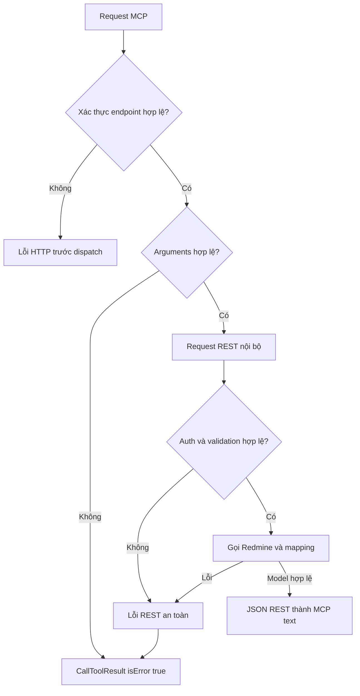

# Luồng request và response MCP :id=mcp-request-and-response-flow

> Bản tiếng Việt được biên tập từ [tài liệu tiếng Anh gốc](#/docs/mcp-request-flow.md). Bản gốc là nguồn chuẩn cho hợp đồng và hồ sơ đầy đủ. Tên API, lệnh, ngày, waiver và giới hạn nghiệm thu được giữ nguyên; việc dịch không thực hiện kiểm thử.

Trang này giải thích source hiện tại qua ví dụ `get_issue`; các reader khác dùng cùng tầng với service/gateway riêng. Đây không phải báo cáo live verification.

## 1. Startup chuẩn bị server :id=1-startup-prepares-the-server

`create_app` kiểm Settings, logging/middleware/error handlers và REST router. HTTPX ASGITransport cho MCP gọi REST trong cùng process; `http://apiserver` chỉ là base URL nội bộ. Registration kiểm catalog và pinned compatibility, override membership DELETE body, phục hồi OpenAPI schema/hint/cache, gắn personal discovery/budget và mount `/mcp`. Description/input schema thuộc feature router. Lifespan tạo client, đăng ký cleanup và chỉ ready sau SDK manager context được enter.

## 2. Kết nối và discovery :id=2-connection-and-discovery

Client gửi `X-Redmine-API-Key` tới `/mcp`; initialize thương lượng protocol, `tools/list` trả tên/description/schema/hint. Reader và pinned writer dùng deployment catalog, không inventory project cho discovery; auth vẫn gọi native. Personal writer dùng bounded request-local project/membership/role evidence. Conditional/unknown không cấp permission. `require_mcp_access` bảo vệ mọi HTTP request, kể cả initialize/discovery; session không thay key. Server message Streamable HTTP có thể tách khỏi tool POST.

## 3. Call công cụ thành công :id=3-successful-tool-call

```json
{"jsonrpc":"2.0","id":7,"method":"tools/call","params":{"name":"get_issue","arguments":{"issue_id":123,"include":"journals,attachments"}}}
```



### Trách nhiệm từng bước :id=responsibilities-at-each-step

Middleware tạo hoặc kế thừa request ID, `X-Request-ID` và timing. Auth kiểm normalized key, gọi identity và áp policy. SDK lookup công cụ, kiểm argument và chuyển path/query/header tới REST nội bộ. Dependency/bootstrap tạo service/gateway theo key người gọi và pool chung. Router kiểm input HTTP; service kiểm nghiệp vụ; port chỉ là interface, không thêm network call. Gateway map resource/query, client giới hạn deadline/body và map status; mapper kiểm envelope/ID/model/omission. FastAPI serialize model, adapter serialize REST JSON thành MCP text.

Khi cả GET thành công ở attempt đầu, `get_issue` cần **ba native request**: identity cho MCP, identity cho REST nội bộ và issue GET. Transient failure có thể thêm attempt theo retry/budget. Không cache identity chung giữa hai request; pool không credential và không truy cập PostgreSQL.

## 4. Client nhận gì :id=4-what-the-client-receives

Adapter hiện trả JSON đã serialize trong `TextContent`, không native `structuredContent`. Transport framing có thể JSON hoặc SSE; client parse text để lấy dữ liệu. Visibility theo caller. `not_returned` ghi field vắng trong upstream mà chưa biết nguyên nhân; `not_requested` ghi expansion chưa chọn. Observation rỗng không chứng minh dữ liệu đầy đủ toàn hệ thống.

## 5. Nhánh lỗi :id=5-error-branches



Key thiếu/sai trả endpoint 401 trước dispatch; upstream identity unavailable map 502/504. Unknown tool hoặc invalid argument có SDK `isError=true`; không gọi feature REST dù endpoint auth đã chạy. HTTP syntax hoặc business validation trả 422. Resource 403/404 được sanitize; 404 không phân biệt absent và hidden. Lỗi native rate/unavailable/network/malformed/oversize thường 502, pool exhaustion 503 và timeout 504; unexpected error trả safe 500 `internal_error`.

Internal REST 4xx/5xx được adapter đưa thành tool error chứa tên/status/safe response. Không chỉ nhìn outer HTTP status để kết luận call thành công. Endpoint/protocol malformed là nhánh riêng.

## 6. Logging và shutdown :id=6-logging-and-shutdown

Log chỉ request ID, operation, status, duration và safe code/type; không key, issue body hoặc exception nhạy cảm. Context nội bộ kế thừa và outgoing `X-Request-ID` do server quản lý. Shutdown ngừng manager/task thuộc sở hữu rồi đóng client/transport theo lifespan; failure của một cleanup không bỏ qua cleanup tiếp theo. Cancel được truyền đúng và readiness được giải quyết, tránh task/session bị bỏ lại. Xem [kiến trúc](architecture.md) và [compatibility evidence](testing/evidence/prep-022-026-testing.md).
