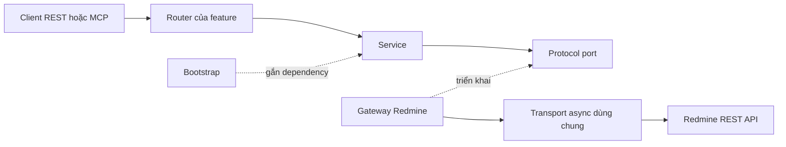

# Các module runtime

Runtime là một ứng dụng nguyên khối chia module theo tài nguyên, tại `src/redmine_mcp/`.
REST router và MCP dùng chung service và ranh giới quyền. Đây là mô tả source hiện tại,
không phải bằng chứng xác minh trực tiếp.

| Module | Trách nhiệm |
| --- | --- |
| `app.py` | Đọc cấu hình, đăng ký middleware/error handler, REST router, MCP và lifespan |
| `config.py` | Kiểm tra cấu hình runtime, giới hạn đọc, writer gates và chế độ tiếp nhận |
| `lifecycle.py` | Quản lý HTTP client upstream/internal dùng chung, MCP readiness và shutdown |
| `bootstrap.py` | Gắn gateway cụ thể vào service port và tạo container theo request |
| `api/` | HTTP dependency, xác thực đầu vào, giới hạn, health, routing và serialize lỗi |
| `auth/` | Principal/context, xác thực, chính sách truy cập và đánh giá capability |
| `mcp/` | Danh mục rõ ràng, đăng ký, sửa schema, tương thích, discovery và giới hạn điều phối |
| `features/` | Model tài nguyên, router, hợp đồng query, service và Protocol port |
| `integrations/redmine/` | Transport upstream, đường dẫn tài nguyên, retry, mapping và mutation receipt |
| `common/` | Lỗi chung, validation, phân trang, visibility và hợp đồng giới hạn đọc |
| `constants/` | Mã lỗi, thông báo an toàn và nội dung log/hợp đồng dùng chung |
| `observability.py` | Request context và cấu hình log đã loại bỏ dữ liệu nhạy cảm |

## Feature theo tài nguyên

Project, issue, user, attachment, time entry và dữ liệu tham chiếu có model và hợp đồng riêng.
Router kiểm tra HTTP input rồi gọi service. Service kiểm tra quy tắc nghiệp vụ và gọi Protocol port.
Gateway Redmine triển khai port, chuyển yêu cầu thành request upstream. Bootstrap chọn triển khai cụ thể.

Service không import FastAPI API hoặc HTTPX. Ngoại lệ hẹp là hằng HTTP status qua
`from fastapi import status as http_status`. MCP không truy cập PostgreSQL trực tiếp.

## Các bước thực thi

1. **Khởi động:** tạo app, kiểm tra cấu hình/danh mục/tương thích, đăng ký route và schema,
   vào lifespan và chờ MCP manager sẵn sàng.
2. **Xác thực và discovery:** kiểm tra key cá nhân tại `/mcp`; tạo danh sách công cụ theo
   deployment hoặc người gọi mà không cấp quyền trên tài nguyên mục tiêu.
3. **Điều phối:** kiểm tra arguments MCP và gọi route REST tương ứng qua ASGI transport nội bộ,
   chuyển tiếp header key được cho phép.
4. **REST và service:** xác thực/kiểm tra quyền request REST, lấy container của request,
   kiểm tra input transport và nghiệp vụ rồi gọi port của feature.
5. **Upstream và mapping:** áp dụng điều kiện tiếp nhận, giới hạn, deadline và kích thước body;
   GET đủ điều kiện có thể retry, còn ghi chỉ thử một lần. Kiểm tra và ánh xạ response upstream.
6. **Response và lỗi:** serialize hợp đồng REST thành MCP text content hoặc lỗi công cụ;
   lỗi endpoint có thể xảy ra trước điều phối.
7. **Dừng:** kết thúc task MCP manager và đóng client/transport do lifespan quản lý.

[Luồng đầy đủ](/vi/docs/mcp-request-flow.md) có sơ đồ sequence và nhánh lỗi.
[Kiến trúc](/vi/docs/architecture.md) mô tả ranh giới import, credential theo request,
phiên bản tương thích, giới hạn và trách nhiệm vòng đời.

## Mở rộng server

Bắt đầu từ [quy trình công cụ](/vi/docs/workflows/redmine-tools.md), rồi
[hướng dẫn phát triển](/vi/docs/development.md#add-a-read-only-tool).
Giữ `operation_id` ổn định, đăng ký MCP rõ ràng, gắn dependency qua bootstrap và cập nhật
hợp đồng công khai. Kiểm thử là giai đoạn cần được cho phép riêng.
